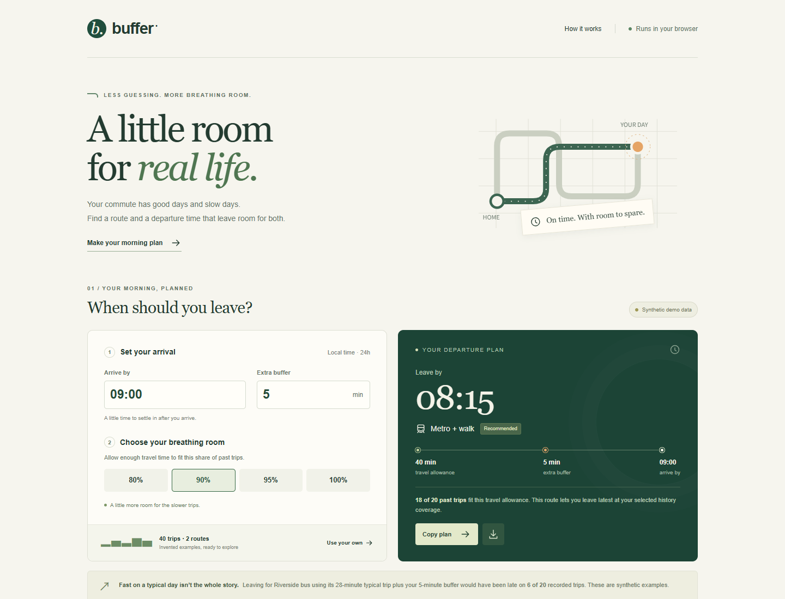

# Buffer

**A little room for real life.** Compare commute histories, choose a route, and work backward from an arrival time to a leave-by time.

Created for NextSpark Hacks 2026. The example persona and all bundled trip records are fictional. This is a working historical comparison tool, not a live transit service or future on-time predictor.



## Run locally

Use Node.js **22.12 or newer** (Node 24 was used for the local checks).

```powershell
cd app
npm ci
npm run dev
```

Open the local URL printed by Vite, including `/buffer-commute/`. No environment file, API key, backend or account is needed. The app downloads no external fonts, maps or data. After loading, calculations and imports work without a network; offline reload is not implemented.

```powershell
npm test
npm run build
npm run preview
```

The production output is `app/dist/`. Serve it over HTTP; do not open `index.html` directly through `file://`.

Optional reproducible browser verification, from `app/`:

```powershell
npx playwright install chromium
npm run test:browser
```

The script serves the built app under `/buffer-commute/`, verifies 14 flows, regenerates screenshots in `assets/`, and writes `app/test-results/browser-report.json`. It closes its server and browser afterward. The calculation and parser suite has 10 tests.

## Use it

1. Set an arrival time and extra buffer, in local time.
2. Choose the share of historical trips to fit. For example, 90% of 20 records uses the 18th sorted duration.
3. Compare routes. The recommendation is the route with the latest computed departure at that setting; you can select a different route.
4. Import your CSV if available, then copy or download the selected plan. Reloading clears imports.

Defaults: arrival 09:00, extra buffer 5 minutes, coverage 90%. The synthetic data recommend **Metro + walk at 08:15**; 80% changes the recommendation to **Riverside bus at 08:19**.

## CSV format

```csv
route,minutes
Campus bus,32
Campus bus,38
Campus bus,35
Campus bus,40
Campus bus,34
```

Use door-to-door whole minutes from similar days and departure times. Both columns are required, in either order. Route names support CSV quoting, including commas and doubled quotes. Multiline fields are not supported. Limits: 100 KB, 500 trips, 6 routes, at least 5 trips per route, each duration 1–360 minutes. Twenty or more relevant observations per route is preferable, but still does not establish a future probability.

The in-app **Download example CSV** exports the 40 synthetic records. [assets/import-demo.csv](assets/import-demo.csv) contains a separate ten-record synthetic example for the video; it recommends Rail at 08:30 using the default controls. Imported files are read in memory only. They are not uploaded or retained in local storage.

## Calculation and limitations

For sorted durations `d` and selected coverage `p`:

```text
rank = ceil(number of observations × p)
trip allowance = d[rank - 1]
leave by = arrive by − trip allowance − extra buffer
```

Ties can make the actual covered share larger than the setting. “Typical” uses the same nearest-rank method at 50%. The comparison note replays a median-based departure with the same buffer against the actual arrival deadline; it counts records longer than `median + buffer` as late.

Small samples, biased logs, service changes and disruptions can invalidate the usefulness of the history. This app does not infer current conditions or model uncertainty. A previous-day departure is labeled explicitly. All dates and times belong to a single journey; no timezone conversion or calendar scheduling is performed. Real-world outcomes have not been measured.

## Deploy yourself

The intended repository is `vars0/buffer-commute`. Keep `app/`, `assets/`, `.github/` and this README at the repository root. The configured Pages base path is **`/buffer-commute/`**. The intended address is `https://vars0.github.io/buffer-commute/`; it has not been published during local preparation.

### GitHub Pages

The included [.github/workflows/pages.yml](.github/workflows/pages.yml) builds `app/`, runs the calculation tests, and publishes `app/dist/` after the repository owner enables it. Repository creation, authentication, push and deployment are performed by the user.

1. Create a public GitHub repository. Push this folder's contents with a `main` branch, including hidden `.github/` and `.gitignore` files. Do not add `node_modules/`, `.env` files or personal trip logs.
2. In **Settings → Pages → Build and deployment**, select **GitHub Actions**.
3. In **Actions → Deploy Buffer to Pages**, select **Run workflow** if the initial push has already run before Pages was enabled.
4. Open the returned Pages URL in a signed-out window. The repository path `/buffer-commute/` matches `vite.config.ts`. If you rename the repository, update the base and re-run the build.

See the [Vite static deployment guide](https://vite.dev/guide/static-deploy) and [relative base documentation](https://vite.dev/guide/build#relative-base).

### Vercel

For root-domain hosting, import the public repository personally. Set **Root Directory: `app`**, framework **Vite**, build command **`npm run build:root`**, output directory **`dist`**. This overrides the base with relative paths. No environment variables are needed. Verify the final URL signed out. See [Vite on Vercel](https://vercel.com/docs/frameworks/frontend/vite).

A live URL is optional under the event rules; the accessible video and public code are required. Neither hosting service has been used or changed by this local preparation.

## Source map

| Path | Purpose |
|---|---|
| `app/src/lib/planner.ts` | Quantiles, route comparison, CSV validation and plan export |
| `app/src/lib/planner.test.ts` | Calculation, edge case and parser tests |
| `app/src/App.tsx` | Controls, result, SVG chart and local file actions |
| `app/src/styles.css` | Responsive interface, focus states and reduced-motion support |
| `app/scripts/verify-browser.mjs` | Production browser flow checks and screenshots |

## Credits and assistance

React, React DOM, Vite, TypeScript, their plugins and development tools are dependencies under their respective licenses; see `app/package.json` and `app/package-lock.json`. The UI uses system fonts and inline SVG. No third-party dataset or image is bundled.

OpenAI Codex assisted with research, design, code, tests, synthetic examples and documentation. There is no runtime AI integration. The demo uses automated browser operation and Windows text-to-speech as presentation tools. This repository makes no award, user-adoption or measured-impact claim.
